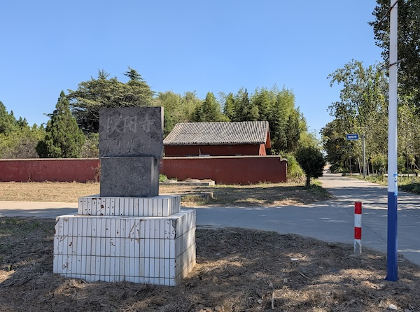
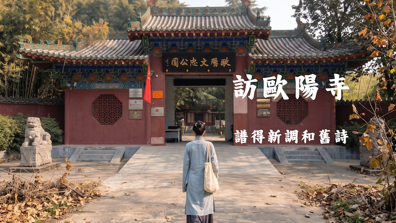
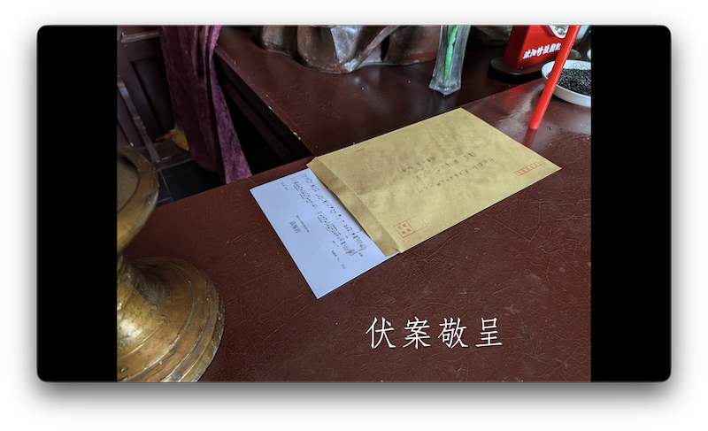
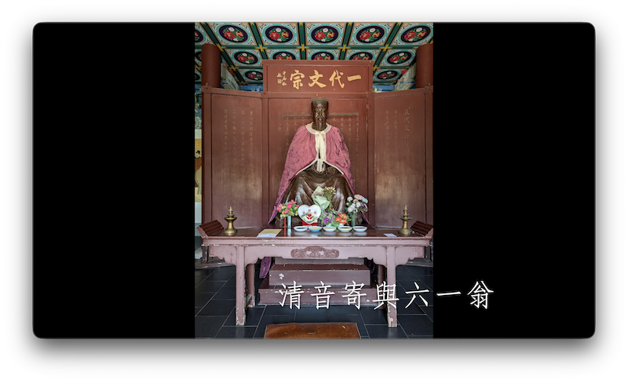
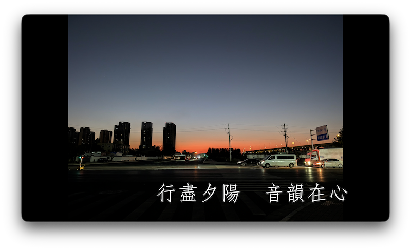
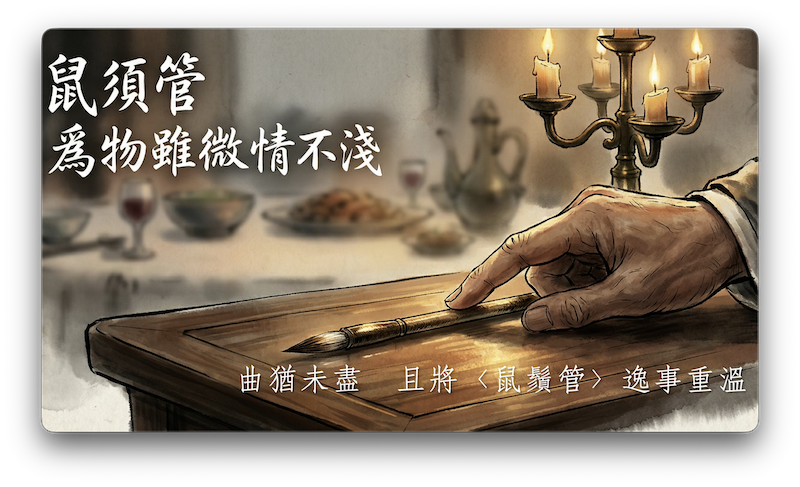

+++
title = "訪歐陽寺：譜得新調和舊詩"
date = "2026-10-16"
[taxonomies]
tags = ["神遊", "訪古", "鼠鬚管", "歐陽脩", "新鄭", "詩詞", "音樂", "視頻"]
+++

## 神遊與踐約

清明[神遊](/blog/shu-xu-guan)既畢，心曲未歇。歲次丙午仲秋，復製慢板弦歌，親赴新鄭歐陽文忠公陵園伏案敬呈。

| 昔日神遊・虛境構想 | 今秋實訪・真跡印證 |
| :---: | :---: |
|  |  |

> **「步履重疊，虛實於此交會。」** \
> 當初依託想像畫下的立足點，終在金秋時節，真真切切踏在了同一方土地上。

<!-- more -->

## 訪古紀行

> 觀看全片：[嗶哩嗶哩](https://bilibili.com/video/BV1dCJ16uEBd/) ｜ [YouTube](https://youtu.be/IrQGkql7gVc)

入得拜殿，於文忠公几前敬獻手書告文與新製樂譜。千載之下，以今時新譜叩問先賢，斯文相接，默然有契。

| 伏案敬呈 | 遙寄清音 |
| :---: | :---: |
|  |  |

## 慢板〈鼠鬚管〉

暮色歸途，樂曲兩度周回。正片尋訪既訖，餘音未了，遂借《奉送原甫侍讀出守永興》詩意，隨慢板琴弦重溫《鼠鬚管》贈筆逸事。曲終畫盡，神遊之約方告圓滿。

| 暮色歸途 | 逸事重溫 |
| :---: | :---: |
|  |  |
