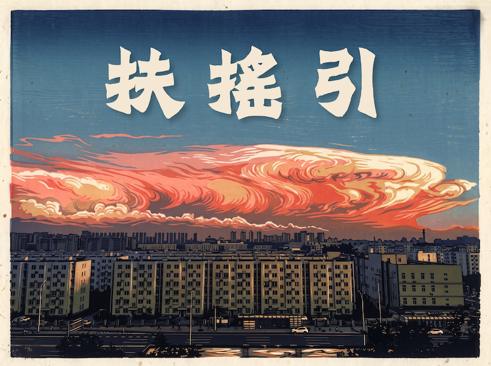

+++
title = "《扶搖引》(Envole-moi) 中州韻古風填詞與套色木刻影音誌"
date = "2026-10-30"
[taxonomies]
tags = ["法語歌曲", "國風改編", "中州韻", "套色木刻", "音樂", "視頻"]
+++

原作《Envole-moi》，乃法蘭西樂師高德曼（Jean-Jacques Goldman）經典名曲。開篇以「午夜高塔下萬籟俱寂、黑夜掩蓋破敗街區」起興，講述身處愚昧與不公泥沼中的青年，立誓以知識翻越高牆、改變宿命的渴望。(« À coup de livres, je franchirai tous ces murs »)

今居戎氏御電腦、依《中原音韻》蕭豪韻填詞，取《莊子·逍遙遊》「摶扶搖而上者九萬里」之意，演爲《扶搖引》。並假虛擬歌聲合成（ACE Studio）合樂，融合二十幅實景攝影轉印套色木刻版畫與北宋傳世畫卷《千里江山圖》《瑞鶴圖》，借現代聲畫技術演繹西曲東漸之變，聊供同好切磋遣興。

<!-- more -->

改編作品重現了原作中「困頓—覺醒—突圍—高飛」的精神內核：將原曲的「午夜高塔與被操弄的規則」化爲「嘆塵囂、冷似鐵鎖困龍鱗老」；將「未曾選擇生於泥沼、立誓翻越高牆」化爲「非我願居泥沼，寸心焚烈火難消；乘風嘯，斬斷樊籠破霧凌霄」，並以長空振翎、破雲翱翔之勢直衝霄漢。

> 觀賞音樂視頻：[嗶哩嗶哩](https://www.bilibili.com/video/BV1vZxi68E6t/) ｜ [YouTube](https://youtu.be/w-5Wys4zhD0)

---

## 一、 樂理編配與視覺意象

- **引子與主歌（第 1–16 小節）· 沉淪蓄勢**：`C` 小調。以極簡室內樂洗去原曲電聲喧囂。開頭將男聲「夜迢，朔風狂嘯」跨小節前移，使「嘯」字下沉於第 3–4 小節大提琴深沉低音區，並留出第 4 小節後半拍的二胡過門（`Eb4 - F4 - G4 - Bb4`），營造寒夜孤寂的呼吸間歇；第 14–16 小節二胡聲部以 `[F4 - Ab4]`、`[C5 - G4]` 五度跳進折返與 `[G4 - C5]` 鏡像應答，以極具金石感的刀刻線條托起主歌第三疊的蓄力推進。

- **破局催拍（第 17–18 小節）· 靈光乍現**：全曲關鍵轉折樞紐。「摶搖」長音處突兀引入西洋古典「皮卡第三度」（還原 `E4`，在幽暗小調中驟然綻開明澈如洗的 `C` 大三和弦），如神光破雲，完成了困龍掙脫鐵鎖、直上長空的瞬間蛻變。

- **副歌・流水板（第 19–28 小節）· 驚濤穿雲**：轉入 `F` 小調（4 個降號），速度自 `92 BPM` 催推至 `96 BPM`，藉中國戲曲緊打慢唱的「流水板」重鑄副歌律動。「破開雲濤」「凌險嶠，穿雲」處男女聲錯位追逐、緊湊應答，如雙禽逆風盤旋，直至「萬壑小」並翅合流，並在第 28 小節「逍遙」處以 `Fm/C` 轉 `C` 大三和弦從容叫散收束，天地豁然開朗。

- **尾聲・扶搖迴旋（第 29–36 小節）· 雙羽凌霄**：以巴洛克低音下行基底（`Cm → Cm/Bb → Fm/Ab → G`）築底，女聲（長笛聲部）與男聲（二胡聲部）化作兩道翻飛氣流展開卡農輪唱對位，一引一隨、互爲羽翼，最終在第 33 小節「振翅凌霄」處凌空拔起、直推至全曲最高音 `G5`，於乾坤浩渺中完成終極昇華。

- **視覺畫面**：前奏以向原曲致敬的藍白紅三連版畫破題；前半段配以人間燈火、深沉雷雨與都市樓羣之套色版畫；第 17 小節「摶搖」閃白後，畫面由逼仄塵寰轉向壯闊天地，以 Ken Burns 運鏡飛越宋徽宗趙佶《瑞鶴圖》與王希孟《千里江山圖》；尾聲雙聲部輪唱，畫面以實景轉印壓軸版畫《雙鳥掠過雪山霞光》定格收官。

---

## 二、 演職與編制題記（Crédits）

- 原曲 / Chanson originale : « Envole-moi » — Jean-Jacques Goldman (1984)
- 對唱規制 / Référence Duo : Génération Goldman (M. Pokora & Tal, 2012)
- 填詞與古譯 / Paroles & Traduction classique : 居戎氏御電腦、依《中原音韻》蕭豪韻填詞並譯
- 編配 / Arrangement : 居戎氏（民樂四重奏 / 鋼琴四手聯彈）
- 視覺版畫 / Gravure sur bois : 實景攝影轉印套色木刻
- 製譜 / Gravure musicale : MuseScore Studio 4
- 歌聲合成 / Synthèse vocale : ACE Studio
- 樂器編制 / Instrumentation :
  - 女高音 / 長笛 (Flûte / Voix Féminine)
  - 男中音 / 二胡 (Erhu / Voix Masculine)
  - 豎琴 (Harpe)
  - 大提琴 (Violoncelle)

---

### 🇫🇷 Note d'intention (法文說明)

Adaptation en chinois de **« Envole-moi »** de Jean-Jacques Goldman (1984), inspirée par la version en duo de *Génération Goldman* (M. Pokora & Tal, 2012).

Là où le texte original raconte la volonté de s'arracher à une *« zone sale »* et de *« franchir tous ces murs »* à coup de livres, les paroles chinoises empruntent l'image du **Fuyao (扶搖)** — le grand tourbillon décrit par le philosophe Zhuangzi qui porte l'oiseau géant jusqu'aux nuées. Le texte chanté suit strictement la rime classique *Xiao-Hao (-ao/-iao)* issue du *Zhongyuan Yinyun* (phonologie traditionnelle de l'opéra chinois), accompagné d'une traduction littéraire intégrale en chinois archaïque (*« 舉我乘風 »*) mêlant le style tétrasyllabique du *Classique des Vers (Shijing)* et la prosodie des *Élégies de Chu (Chuci)*. La vidéo intègre vingt gravures sur bois polychromes réalisées par transfert photographique, associées aux chefs-d'œuvre picturaux des Song du Nord (*Mille Li de rivières et de montagnes* et les *Grues auspicieuses*).

---

## 三、 《扶搖引》中州韻唱詞（依《中原音韻》蕭豪韻）

**〔引子〕**

（男）夜迢，朔風狂嘯！

**〔主歌一・慢板〕**

（男）嘆塵囂，夜漫迢，冷似鐵鎖困龍鱗老。

（女）望重霄，路渺遙，怎甘折翼陷入蓬蒿！

**〔主歌二・緊湊推進〕**

（男）非我願居泥沼，寸心焚烈火難消；

（女）乘風嘯，斬斷樊籠破霧凌霄！

**〔過渡・催拍破局〕**

（女）摶搖——

（男）憑誰引我出牢！

**〔副歌・流水板〕**

（合）飛兮——扶搖！飛兮——上九霄！

　　　縱千里狂飆怒號，任滄海橫流滔滔；

　　　破開雲濤，凌險嶠，穿雲，萬壑小，

　　　振翎掠乾坤浩渺，回望塵寰渺，逍遙！

**〔尾聲・雙鶴盤旋（雙聲部輪唱）〕**

（女）飛越塵囂，穿雲破霄，萬里憑眺，嘯，摶風扶搖，振翅凌霄，滄海滔滔，乾坤浩渺任逍遙！

（男）隨風扶搖，共上九霄，煙塵渺渺，萬里雲濤，乘風扶搖，碧落迢迢，凌雲長嘯！

---

## 四、 法語原詞古體全譯：《Envole-moi・舉我乘風》

### 〔上闋〕

* **Minuit se lève en haut des tours**\
子夜方升，危樓之巔。
* **Les voix se taisent et tout devient aveugle et sourd**\
萬籟俱寂，舉世盲聾。
* **La nuit camoufle pour quelques heures**\
夜幕須臾，聊蔽荒穢；
* **La zone sale et les épaves et la laideur**\
垢壤殘骸，醜惡畢蒙。
* **J'ai pas choisi de naître ici**\
生於斯地，非我所願；
* **Entre l'ignorance et la violence et l'ennui**\
處此愚頑、強暴、困倦之間。
* **J'm'en sortirai, j'me le promets**\
吾必脫困，中心自誓；
* **Et s'il le faut, j'emploierai des moyens légaux**\
苟有其要，將循正道以破樊籠。

### 〔下闋〕

* **Pas de question ni rébellion**\
無由詰問，莫敢抗逆；
* **Règles du jeu fixées mais les dés sont pipés**\
成規既定，博具早詐。
* **L'hiver est glace, l'été est feu**\
冬則凝冰，夏則爍火；
* **Ici, y'a jamais de saison pour être mieux**\
居此窮巷，四時靡樂。
* **J'ai pas choisi de vivre ici**\
活於斯地，非我所擇；
* **Entre la soumission, la peur ou l'abandon**\
委順、惶怖、自棄之淵。
* **J'm'en sortirai, je te le jure**\
吾必自拔，指天爲誓：
* **À coup de livres, je franchirai tous ces murs**\
將此書冊，以逾墉垣！

### 〔副歌與尾聲・楚辭體〕

* **Envole-moi, envole-moi, envole-moi**\
舉我乘風兮，扶搖高翔！
* **Loin de cette fatalité qui colle à ma peau**\
遠附骨之宿命兮，脫彼桎梏；
* **Remplis ma tête d'autres horizons, d'autres mots**\
拓靈府以遐荒兮，納殊方之嘉言。
* **Me laisse pas là, emmène-moi, envole-moi**\
毋遺我於斯地兮，挈我凌雲；
* **Croiser d'autres yeux qui ne se résignent pas**\
將遇彼不屈之眸兮，共睇九霄。
* **Regarde-moi bien, je ne leur ressemble pas**\
試諦視吾貌兮，豈與彼輩同流？
* **Avec ou sans toi, je n'finirai pas comme ça**\
縱偕行與孤往兮，誓不如此而終休！

---

## 五、 版權規約（Mentions légales）

本作品原曲《Envole-moi》之詞曲著作權歸原作者 Jean-Jacques Goldman 及其版權代理機構所有。此中州韻填詞與民樂改編版（《扶搖引》）僅供個人音樂研習與非商業性文化交流，無任何商業變現行爲；視頻所引北宋王希孟《千里江山圖》與宋徽宗《瑞鶴圖》均屬公共領域文化遺產。如有版權疑慮請私信聯繫，將於收到通知後立即配合撤除。

*Adaptation chinoise à but strictement non commercial. Tous les droits sur l'œuvre originale « Envole-moi » appartiennent à Jean-Jacques Goldman et à ses éditeurs respectifs (Éditions JRG / Sony Music). Les peintures classiques de la dynastie Song utilisées dans la vidéo relèvent du domaine public. Si les ayants droit souhaitent le retrait de cette publication, veuillez me contacter directement.*
