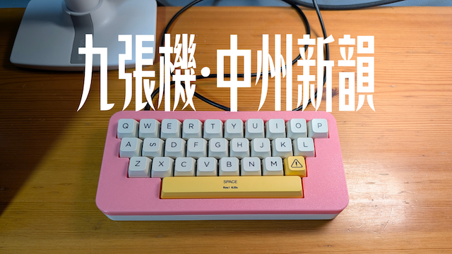
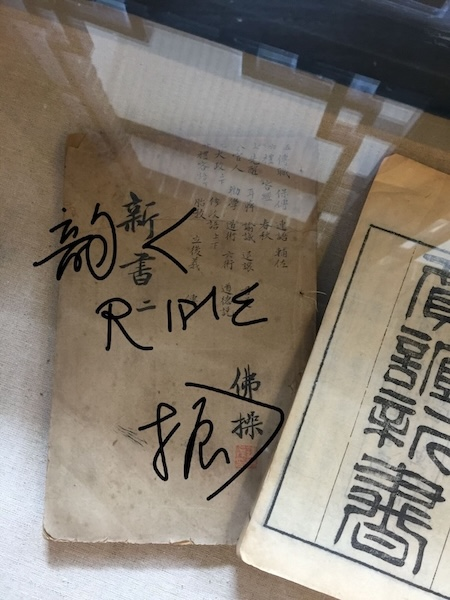

+++
title = "九張機·中州新韻"
date = "2026-11-11"
[taxonomies]
tags = ["中州韻", "詩詞", "鍵盤", "宮保拼音", "音樂", "視頻", "R2ime"]
+++

> 五張機，紛紜鍵紐總歸齊。八方樞要咸由我，指梢調度，綱舉目張，莫使令行遲。

在打字機的鍵音與織布機的機杼聲之間，存在着一種奇妙的同構——\
都是指尖在維度受限的陣列上穿梭，織就思想與語言的錦繡。

織工受限於機杼寬窄，方有經緯穿梭之精微；打字者受限於廿七鍵陣，乃有宮保並擊之奇思。

此曲借宋代樂府《九張機》之織造機杼，詠新一代輸入法引擎 R²ime 的微觀架構，品鑑聲律美學。

<!-- more -->

> 請觀賞音樂視頻：[嗶哩嗶哩](https://www.bilibili.com/video/BV1RGWJ6uEGb/) ｜ [YouTube](https://youtu.be/ZYxgZD0JvqY)

### 硬體與視聽演示

- **鍵盤兄：pain27**

  這是一把僅有 27 顆（+1 顆選配）按鍵的極簡客製化鍵盤。\
  苦茶紫軸帶來的提前大段落感與 Gasket 結構的溫潤回彈，在高頻擊鍵時反饋明晰、剛柔並濟。\
  在如此極致的物理按鍵限制下，常規的逐字串行敲擊已不可行，必須依賴算法層面的宮保拼音（Combo Pinyin）並擊方案，化平鋪爲立體。

- **lotem/typewriter 宮保拼音跟打實況**

  在畫面上方，typewriter 打字練習器實時捕獲按鍵並擊信號。\
  雙手同按，數個按鍵開關在瞬間被解構爲音節與字詞，展現了從信號源到走紙渲染的完整微觀鏈路。

- **Keysight 音符瀑布與中州曲韻聲律調校**

  在畫面下方，Keysight 鋼琴音符瀑布流隨曲調傾瀉。
  
  配樂《九張機·中州新韻》爲古詞牌譜成新曲，採用燕樂 E 羽調式（G 宮系統）。\
  全曲於羽、宮、商、角、徵五正聲中，巧妙點染四味偏音：\
  清角（C♮）如幽澗含蓄，變徵（C♯）若孤峰突起；\
  變宮（F♯）引懸念之將解，清羽（F♮）泛秦漢之古蒼。\
  四音穿梭映現，激盪出中州曲韻獨有的骨格。
  
  三重奏中，鋼琴以空五度沉靜鋪陳骨架，二胡以隨腔附影之姿跌宕起伏，大提琴拉動沉穩低音統攝底層。
  
  唱詞基於中原官話音系，由 ACE Studio 虛擬歌手演繹，逐字嚴校「分尖團」字音。\
  前奏無詞吟唱如雲霧初開，句末托腔折回餘韻悠長，與畫面上鍵位走紙的點擊節奏呼應無間。

### 微觀七境與架構九引

在微觀引擎層面，輸入法的本質是從連續物理事件到語言符號概率圖的投影過程。

「微觀七境」立足於單個字符落筆的微秒時序：\
鍵擊源 → 手法池 → 棱鏡折射 → 韻書探幽 → DAG 構詞 → 機關排序 → 走紙渲染；\
而「架構九引」則更進一步，自下而上重構了 R²ime 的宏觀系統工程：

一引·一張機：響應式工作流，脈絡牽引，潮回波湧，信手自通微。\
二引·兩張機：抽象輸入輸出，端雲無界，流轉自如。\
三引·三張機：可配置主流程，靜態圖編排 × 原生執行，重開天地定玄思。\
四引·四張機：繪製界面藍圖，視窗構形，方寸得宜。\
五引·五張機：統一按鍵綁定，紛紜鍵紐總歸齊，八方樞要咸由我。\
六引·六張機：支持異步運算，深潭蓄水，併線通衢。\
七引·七張機：可讀中文編程，詞林規範，字句相映，精義露端倪。\
八引·八張機：配方組合構建，萬卷交織，一機統攝。\
九引·九張機：七境合詠，鑄就傳神中州新韻。

走紙競速凌虛去，方知九引發韶光。

`librime1` 打磨了十五年，薪火不斷；以新法式淬鍊的 `R²ime` 宏圖初展。\
底層代碼在變，工程工具在換，但那份「讓文字自在流淌」的初衷未曾停歇。\
指梢調度，綱舉目張。謹以此曲此篇，記這段以算法重開天地、以清曲重修正韻的求索歷程。

*《賈誼新書》舊刻點化：借卷次小字「二」改題「韻新書」「R²IME」，末署「佛操」易作「佛振」。*
